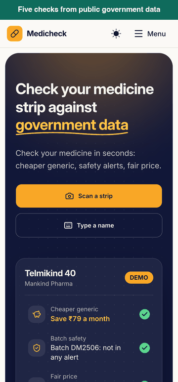
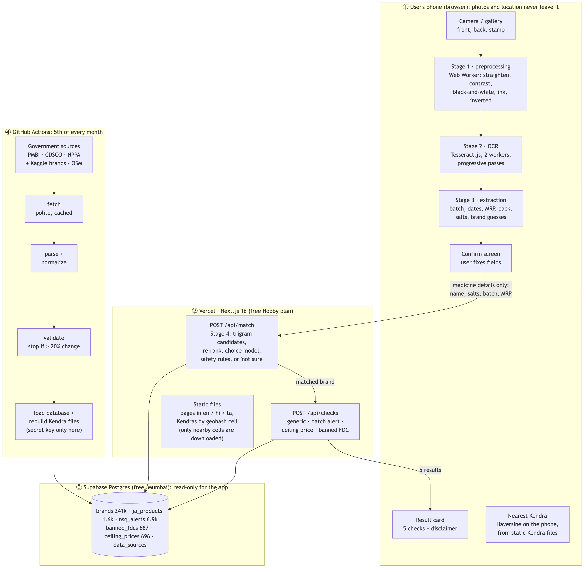

# DawaCheck

**Photograph an Indian medicine strip; get a cheaper Jan Aushadhi generic, batch-safety alerts,
a fair-price check, banned-combination check and the nearest Jan Aushadhi Kendra, from public
government data, read on your phone, at ₹0 cost.**

**Live:** https://dawacheck-psi.vercel.app (English, हिन्दी, தமிழ்) · B.Tech CSE (AI & ML) class
project.

<p align="center"></p>

> **Medical disclaimer.** DawaCheck gives information from public government data. It is not
> medical advice. It never tells you to stop or change a medicine: show the result to your
> pharmacist or doctor.

## Features

| Check                       | What it does                                                                                                                                                        | Data                                    |
| --------------------------- | ------------------------------------------------------------------------------------------------------------------------------------------------------------------- | --------------------------------------- |
| Cheaper generic             | Jan Aushadhi product with **exactly** the same salts, strengths, form and release type, and the saving per pack and per month                                       | PMBI product & MRP list                 |
| Batch safety                | Is this batch in a CDSCO "Not of Standard Quality" or spurious-drug alert? Same batch number **and** same product or maker; an uncertain batch is never called safe | CDSCO alerts, 2019 – now                |
| Fair price                  | MRP per unit vs the NPPA ceiling price + GST (12% before the Sept 2025 cut, 5% after, by manufacturing date)                                                        | NPPA orders S.O. 1575(E), 1581(E), 2026 |
| Banned combination          | On a CDSCO prohibited fixed-dose-combination list? Compares salts, strengths, form and release; court stays and revocations shown as such                           | CDSCO FDC lists                         |
| Nearest Jan Aushadhi Kendra | The 3 nearest, by GPS or PIN code, computed on the phone from static files, with Call and Directions                                                                | PMBI Kendra list                        |

Three ways in: **scan** (front, back and an optional close-up of the batch stamp), **type** a
brand name, or **Demo mode** (two sample strips, so a demo never depends on the light in the
room). For a full demo, [demo/](demo) has 18 ready-made strips (front, back, stamp) covering
every feature, each verified on the live site. Light, dark or "same as phone" theme. Accessible (Lighthouse accessibility 100, large-text switch, 48 px tap targets, never
colour alone) and in three languages.

## How it works



Source: [docs/architecture.mmd](docs/architecture.mmd).

1. **Preprocessing** (on the phone, in a Web Worker): scale to 1600 px, straighten (projection
   profile), contrast stretch, adaptive black-and-white (Bradley), inverted, and an "ink" image
   (max − min of R, G, B) that removes silver-foil glare.
2. **OCR**: Tesseract.js in the browser, 2 workers, progressive passes (cheap pass first; more
   image versions and sideways stamp reads only if key fields are missing).
3. **Extraction**: rules for batch, dates, MRP, pack size, salts and strengths, form; brand =
   tallest plausible lines. Unclear values are left empty for the user to fill in.
4. **Matching** (server): trigram search for candidate brands, evidence (name, strength,
   ingredients, form, release, maker), a conditional-logit choice model fitted by gradient
   descent, and safety rules it cannot override (never answer a contradicted strength or form).
   Below the threshold it says **"not sure"** and offers the top 3.
5. **Checks** against the database; generics only on an identical composition key.

## Results

Measured by the evaluation harness (`pnpm eval`, `pnpm eval:match`), which runs the same code
as the app. The tables below are **development-set** numbers (what we tuned on). The frozen test
set was evaluated **once**, after a person checked the labels; its results follow each table.

**Finding the right medicine** (207 simulated strips from real brands with OCR-like errors,
never used for tuning; 1 in 4 is not in the brand list, so "not sure" is right):

| Method                                      | Right first choice | Wrong answers | Right in top 3 |
| ------------------------------------------- | ------------------ | ------------- | -------------- |
| Exact name only (baseline)                  | 62.6%              | 2.9%          | 62.6%          |
| Trigram search, always answers (baseline)   | 81.0%              | 30.5%         | 90.8%          |
| + re-ranking by ingredients, strength, form | 85.9%              | 26.3%         | 90.2%          |
| **DawaCheck: + abstains when unsure**       | **85.9%**          | **3.3%**      | **90.2%**      |

Abstention is what removes the wrong answers: 26% → 3%, at the cost of saying "not sure" for 28%
of in-list strips. Wrong _generic_ given: 0%. Simulated strips are easier than real photos.

**Reading the strip** (13 real development photos, vs plain Tesseract on the untouched photo):

| Field       | DawaCheck right | DawaCheck wrong | Plain OCR right |
| ----------- | --------------- | --------------- | --------------- |
| Batch no.   | 3/3             | 0/3             | 1/3             |
| Mfg date    | 3/4             | 0/4             | 1/4             |
| Expiry      | 3/4             | 0/4             | 1/4             |
| MRP         | 1/4             | 0/4             | 0/4             |
| Pack size   | 3/10            | 0/10            | 1/10            |
| Ingredients | 1/9             | 3/9             | 0/9             |
| Brand       | 0/13            | 3/13            | 0/13            |

**Frozen test set** (3 photos, labels checked by a person, run once on 2026-10-25): no field was read correctly; wrong values shown: brand 1/3, ingredients 2/2; plain OCR read 1 of 2 pack sizes, DawaCheck none. Two of the three are foreign packs (French Augmentin, German Sortis) and OCR confidence was only 23–44%, so almost nothing was readable. The run also exposed a defect: with no back photo, the merge step counts the missing back as a fully confident reading, which doubled weak front readings and let garbage ingredients ("Cee 8000 mg") past the bar for showing free text. The test result stands as measured.

**Fixed after the final run** (2026-10-25, checked on the 13 dev photos only; the test-set numbers above were measured before the fix and are not re-run): a photo without a back side now counts only the front's own confidence. Dev photos: wrong values shown 8 → 6 (one garbage name and two garbage ingredient lines no longer shown), batch, dates, MRP and pack size unchanged, speed unchanged; one correct but low-confidence name ("Suhagra-100") is no longer pre-filled, yet its automatic match still succeeds through the brand guesses.

Reading time on a laptop: 7.1 s median, 10.8 s p95 (was 9.9 s / 16.8 s before the 2-worker
reader). On real photos the user's name correction matters: with names as confirmed, 3/5
in-list photos matched and 0 were wrong; fully automatic, 1/5 and 0 wrong. On the test photos, with the names a user would confirm: 1 of 2 in-list strips matched (Valium 10mg, 86%), 0 wrong; Augmentin said "not sure" (several strengths, none read) and Sortis correctly said it is not in the list. The always-answer baselines got 67–100% of their answers wrong. Fully automatic: 0 right, 0 wrong (all three abstained).

**Checks:** banned-list rules 40/40 cases; NSQ alerts vs CDSCO's own PDFs 170/172 (98.8%);
ceiling prices 30/30 exact, price verdicts 60/60. Generic lookup hand check: 16/20 right, 0 wrong
(4 safe misses).

Details: [eval/results.md](eval/results.md), [eval/match-results.md](eval/match-results.md),
[eval/m5-checks.md](eval/m5-checks.md).

## Data sources and licences

| Source                                                                                                                  | Publisher                    | Licence / terms                                                                               |
| ----------------------------------------------------------------------------------------------------------------------- | ---------------------------- | --------------------------------------------------------------------------------------------- |
| Jan Aushadhi product & MRP list; Kendra list                                                                            | PMBI, Government of India    | Public government data                                                                        |
| Drug alerts (NSQ, spurious); prohibited FDC lists                                                                       | CDSCO                        | Public government data                                                                        |
| Ceiling prices, orders S.O. 1575(E) and 1581(E), 25.03.2026                                                             | NPPA                         | Public Gazette notifications                                                                  |
| [A-Z Medicine Dataset of India](https://www.kaggle.com/datasets/shudhanshusingh/az-medicine-dataset-of-india), Nov 2022 | Shudhanshu Singh (Kaggle)    | **CC BY-SA 4.0**; the brand tables DawaCheck builds from it are shared under the same licence |
| Map tiles, geocoding (Nominatim)                                                                                        | © OpenStreetMap contributors | ODbL                                                                                          |

A GitHub Action refreshes everything on the 5th of each month (polite: rate-limited, clear
User-Agent, cached; never bypasses a login or CAPTCHA) and refuses to load a table that changed
by more than 20%. Each source's last refresh date is on the About page.

## Privacy

- Photos are read on the phone and **never uploaded**.
- Location is used on the phone only, to sort Kendras. The phone downloads the Kendra file for
  its ~156 km square (geohash), so the server can see at most that rough area, never the point.
  Map tiles come from OpenStreetMap only if you tap "Show on map".
- When you tap "Find", the medicine details you confirmed (name, salts, batch, MRP) go to the
  server in the request body to search the lists. They are not stored or logged.
- No accounts, cookies, ads or analytics. The database key in the app is read-only (Row Level
  Security); the write key exists only in GitHub Actions secrets.

## Run it locally

Needs Node 24, pnpm 12, and (for the pipeline) Python 3.12 with `uv`.

```bash
pnpm install
cp web/.env.example web/.env.local   # SUPABASE_URL and SUPABASE_PUBLISHABLE_KEY
pnpm dev                             # http://localhost:3000
```

| Command                        | What it does                                                  |
| ------------------------------ | ------------------------------------------------------------- |
| `pnpm test`                    | Unit tests (Vitest, 416)                                      |
| `pnpm build && pnpm test:e2e`  | Playwright end to end, privacy, theme, motion, axe (33)       |
| `pnpm lint` / `pnpm typecheck` | ESLint / TypeScript strict                                    |
| `pnpm eval`                    | Strip reader on the labelled photos (`-- --final`: test set)  |
| `pnpm eval:match`              | Matching evaluation (`--fit` refits the weights on dev cases) |
| `cd pipeline && uv run pytest` | Pipeline tests (197)                                          |

The evaluation photos are not in git (see [eval/README.md](eval/README.md) for where each one
comes from); `/en/eval/label` is a local labelling tool.

## Repository

```
web/        Next.js 16 app: app/[locale]/ pages, app/api/ (match, checks), lib/ai/ (preprocess,
            OCR, extraction, matching), lib/checks/, messages/ (en, hi, ta), tests/, e2e/
pipeline/   Python data pipeline: fetch, parse, normalize, validate, load; raw/ snapshots
supabase/   SQL migrations (tables, search function, Row Level Security)
eval/       Labels, evaluation results, demo-image generators
demo/       18 demo strips by feature (everyday, expensive, batch alert, banned), verified
docs/       Architecture, milestone notes (M0–M7), report, slides, demo script, viva Q&A
```

## Limitations

- **Small photo set:** 16 web photos (13 dev, 3 test); the brief asks for ~200. Real-phone photos
  are still to be added, so the reading numbers are rough.
- **Brand and ingredient reading is weak** on busy real photos (OCR quality is the bottleneck);
  the confirm screen and "not sure" keep it safe, but the user often types the name.
- **Speed:** 7 s on a laptop (3–4 s on the simpler test photos); the brief's target is 5 s on a
  mid-range phone (not yet measured).
- **Brand data is a 2022 snapshot** (prices and new brands may be missing); the app asks for the
  MRP on the strip.
- **English OCR only**; Hindi text on strips is not read. Hindi and Tamil interface texts still
  need a native speaker's review.
- Matching numbers come from simulated strips, which are easier than real photos.

## Future work

Phone photos and a bigger frozen test set; on-device speed (smaller first pass, WebGPU OCR);
Hindi OCR; reading the brand with a small on-device text detector; offline use (PWA, self-hosted
OCR model); a fresher brand list; the family medicine cabinet (dropped from this project).

## Cost

₹0: Vercel Hobby, Supabase free tier, GitHub Actions, OpenStreetMap. No paid API: the app uses no
cloud AI service at all, and no cloud vision fallback is built (`ENABLE_VISION_FALLBACK=false`).
